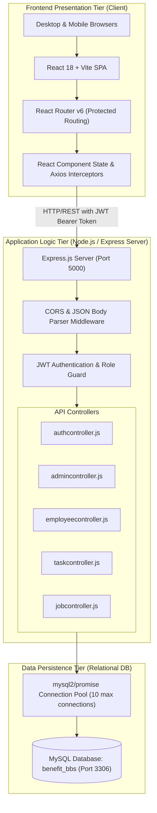
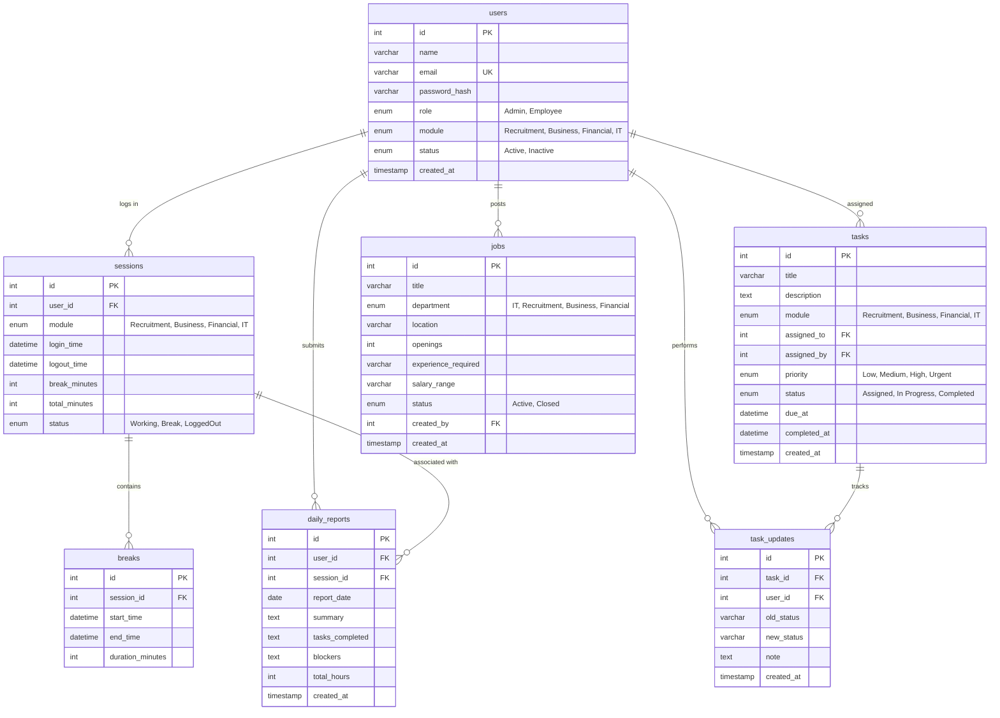

# System Architecture Document

**Project:** Integrated Recruitment, Business & Financial Services Management System  
**Organization:** Benefit Business Solutions Pvt. Ltd.  
**Architecture Style:** 3-Tier Client-Server Architecture (RESTful API + Single Page Application)

---

## 1. High-Level Architecture Diagram

---

## 2. Technology Stack

### 2.1 Frontend Tier
- **Framework:** React 18.x with Vite bundler
- **Routing:** `react-router-dom` v6
- **HTTP Client:** `axios` with global interceptors attaching `Authorization: Bearer <token>` and `x-session-id`
- **UI Styling:** Custom CSS, Google Fonts (`Plus Jakarta Sans`, `Caveat`), Bootstrap 5 utility grid
- **State Management:** React Native Hooks (`useState`, `useEffect`, `useCallback`)

### 2.2 Backend Tier
- **Runtime:** Node.js (v18+)
- **Web Framework:** Express.js 4.x
- **Authentication:** `jsonwebtoken` (JWT), `bcryptjs` for salted password hashing
- **Environment Management:** `dotenv`

### 2.3 Database Tier
- **Database Engine:** MySQL 8.0+
- **Driver:** `mysql2/promise` with connection pooling
- **Schema Name:** `benefit_bbs`

---

## 3. Database Entity Relationship (ER) Schema

---

## 4. API Endpoints Map

| Method | Endpoint | Protection | Description |
|---|---|---|---|
| `POST` | `/api/auth/login` | Public | Authenticates credentials, creates active session, issues JWT |
| `POST` | `/api/auth/logout` | Protected | Closes active session, timestamps logout |
| `GET` | `/api/admin/live-employees` | Protected (Admin) | Real-time live status and current task of all employees |
| `GET` | `/api/admin/stats` | Protected (Admin) | Summary counters: Working, On Break, Logged Out, Total |
| `POST` | `/api/tasks` | Protected (Admin) | Creates new task and assigns to specific employee |
| `GET` | `/api/employee/dashboard-data`| Protected (Employee) | Session timer, today's tasks, live metrics, activity timeline |
| `POST` | `/api/employee/break/start` | Protected (Employee) | Starts break, toggles session status to 'Break' |
| `POST` | `/api/employee/break/end` | Protected (Employee) | Resumes session to 'Working', records duration |
| `PUT` | `/api/employee/tasks/:id/status`| Protected (Employee) | Updates status (In Progress, Completed) |
| `POST` | `/api/employee/daily-report` | Protected (Employee) | Submits end-of-day report and logs out |
| `GET` | `/api/employee/work-log` | Protected (Employee) | Historical sessions, working hours, and completed tasks |
| `GET` | `/api/jobs` | Protected | Fetches all open job vacancies with creator details |
| `POST` | `/api/jobs` | Protected | Publishes a new job vacancy |

